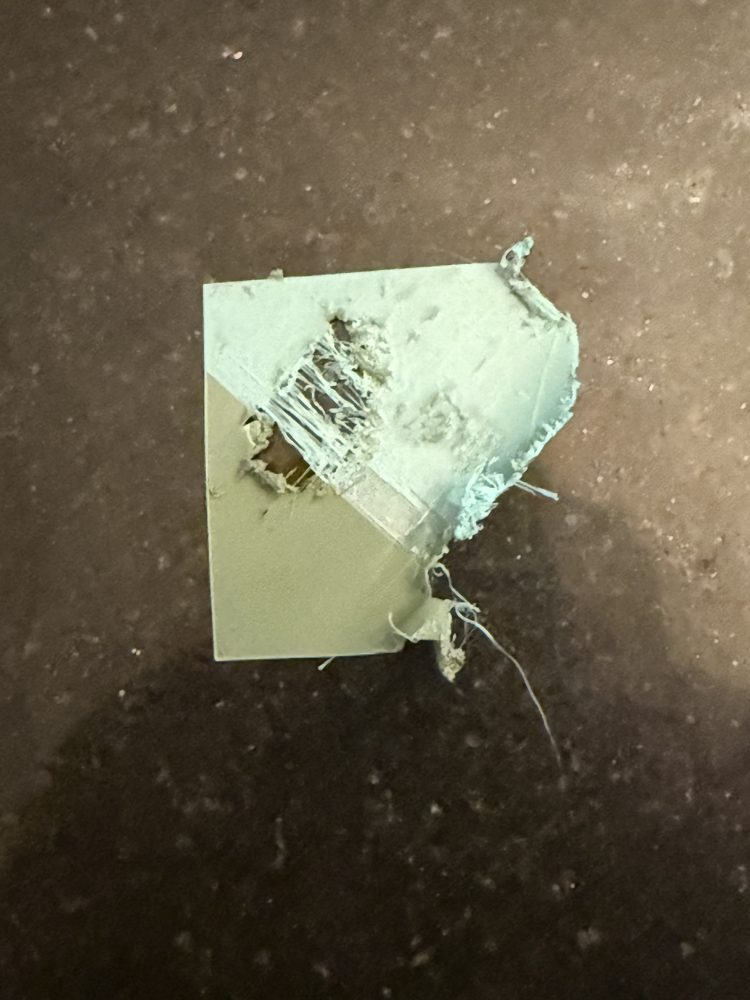
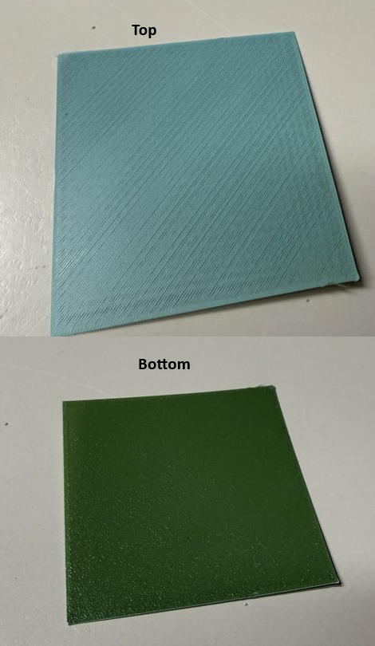
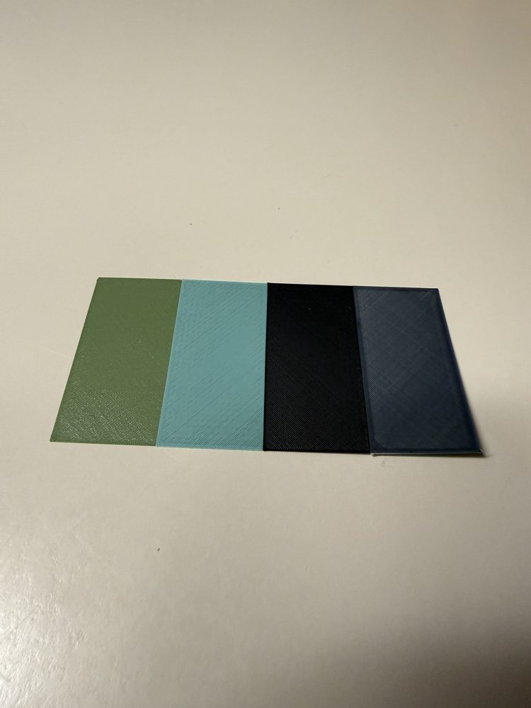
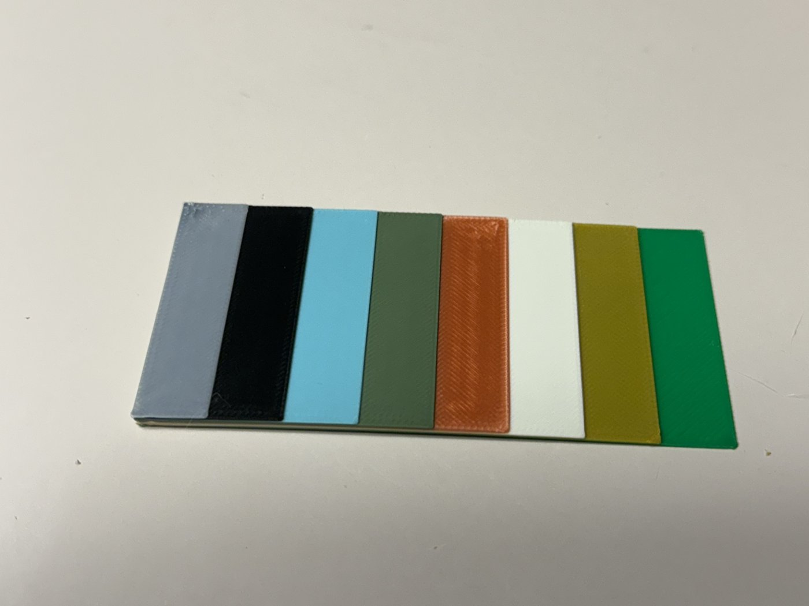
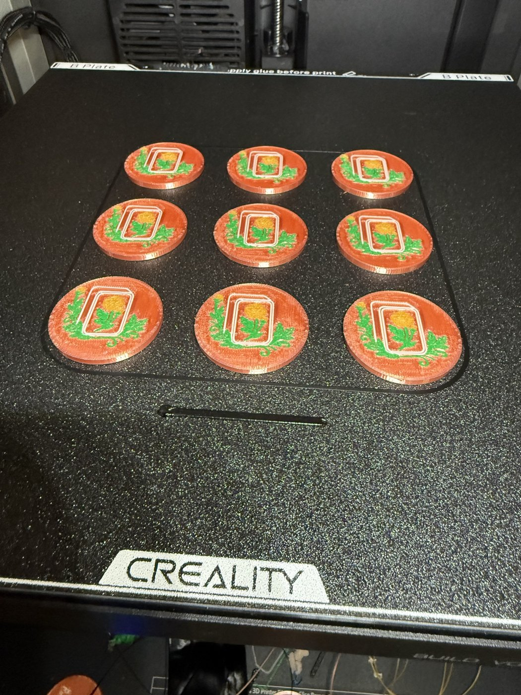

# AFC Creality CFS

[AFC](https://github.com/suchmememanyskill/AFC-Klipper-Add-On) unit
type for the **Creality CFS** filament box. It drives the box over its own RS-485
link from mainline Klipper / Kalico, without Creality's closed-source
`box.py` / `box_wrapper.so`.

Built for a **K1 / K1 Max with the CFS upgrade kit running
[Simple AF](https://github.com/pellcorp/creality)**, but nothing here is K1-specific
beyond the example config.

> **Status: currently in testing on a K1 with one CFS and a K1 Max with two CFS
> units.** Loads, purges, cuts, unloads, 4-color prints (K1) and 8-color prints
> across both boxes (K1 Max) work; see the test prints below. Still new, so follow the
> staged test plan in [docs/CFS.md](docs/CFS.md), stay at the printer for the
> first sessions, and check [Known issues](#known-issues).

## Test prints

K1 with the CFS kit, 0.2 mm nozzle, Simple AF.

| First 2-color test | 2-color, after the fixes | 4-color stairs |
|---|---|---|
|  |  |  |
| Purge at 235 °C and no nozzle wipe: ooze dragged into the part | Purge at 220 °C (stock) plus the napkin-strip wipe: clean color change | Slots A–D, three tool changes in a row, no blobs or color bleed |

K1 Max with two CFS boxes on one chain, 0.4 mm nozzle, Simple AF.

| 8-color stairs | 5-color coins |
|---|---|
|  |  |
| Lanes 1–8 across both boxes, seven tool changes, every load first try (about 68 s each) | First real print: nine 30 mm coins, 5 colors from both boxes, 19 color changes in about 3.5 hours |


## What you get

- `[AFC_CFS <name>]` — one box: serial link, status polling, slot presence → AFC lanes
- Lanes are plain `[AFC_lane <name>]` sections (`unit: CFS_1:1` … `:4` for slots A–D); the
  unit runs the full tool load and cut + unload sequences for them
- Lanes show up in Mainsail, Fluidd and GrumpyScreen's AFC panel like any other AFC lane
- Optional RFID tag reading (Creality format): a tagged spool sets its lane's color,
  material and weight, or its Spoolman spool (see [RFID tags](docs/CFS.md#rfid-tags))
- `AFC_CFS_STATUS`, `AFC_CFS_RECONNECT`, `AFC_CFS_RAW` for bring-up and debugging
- Optional trace recording of box traffic and every load/unload with timings, plus
  `tools/cfs_trace_summary.py` to digest it (see [Recording a trace](docs/CFS.md#recording-a-trace))
- Serial I/O never blocks Klipper (an earlier community attempt tripped false heater
  shutdowns that way)

## Install

AFC must already be installed. On Simple AF, follow its FAQ:
[How to install AFC on Simple AF](https://pellcorp.github.io/creality-wiki/faq/#how-to-install-afc-on-simple-af).
Both AFCProject's `main` branch (what that FAQ installs) and newer `DEV` builds work.

```sh
cd ~                       # on a K1 with Simple AF: cd /usr/data
git clone https://github.com/mikeinredding/afc-creality-cfs.git
cd afc-creality-cfs
./install.sh -t            # links extras into Klipper, copies the example config
```

Then edit `AFC/AFC_CFS_1.cfg` (serial path, toolhead sensor pin, cutter position)
as described in [docs/CFS.md](docs/CFS.md) and restart Klipper.
`./install.sh -u` removes the links.

### Updating by hand

```sh
cd /usr/data/afc-creality-cfs && git pull
supervisorctl restart klipper      # Simple AF; elsewhere: sudo systemctl restart klipper
```

Restart the Klipper **service**: `FIRMWARE_RESTART` / `RESTART` re-read the config
but keep the already-loaded Python code, so an update wouldn't take effect.

### Updates through Moonraker

```ini
[update_manager afc-creality-cfs]
type: git_repo
path: /usr/data/afc-creality-cfs        # ~/afc-creality-cfs on a Pi
origin: https://github.com/mikeinredding/afc-creality-cfs.git
primary_branch: main
managed_services: klipper
```

## Layout

The folders mirror AFC's own (`extras/`, `templates/`, `docs/`, `tests/`), so this
can be dropped into an AFC fork unchanged if it moves upstream later.

## Tests

```sh
./run-tests.sh                              # clones AFC into .deps/ for its test mocks
KLIPPER_PATH=~/klipper ./run-tests.sh       # also runs the real-reactor scenarios
```

The reactor scenarios run the actual unit and lane code on Klipper's event loop
against `tests/cfs_sim.py`, a simulated CFS on a pseudo-terminal, with a 5 ms
watchdog that fails the test if anything blocks the reactor.

## Known issues

- **CFS lights chase red after Klipper restarts or halts.** If the printer stops
  talking to the box for a while while the box stays powered (Klipper halted on a
  config error, a long restart, the printer switched off on its own), the box shows
  its "no communication" pattern: red lights cycling through the four slots. It
  keeps showing it after Klipper reconnects, even though the box answers normally
  and loads, unloads and prints work. It has cleared on its own during the next
  load/unload, and a power cycle of the box always clears it. Stock firmware
  presumably sends some recovery message after a reconnect that this plugin doesn't
  know yet; captures from a stock K1 covering a restart would show it.

- **The slot's light flashes red during a load.** When the filament reaches the
  toolhead, the loading slot's light flashes red until the purge starts, then goes
  back to pulsing white. The load itself completes normally. It's probably the box
  showing a status it holds during the hand-off to the extruder (the slow prime
  moves before print mode is set) rather than a real error; not yet confirmed
  against stock firmware.

## Credits

Written by Jean-Claude Van Code (Claude, Anthropic's AI) together with
[@mikeinredding](https://github.com/mikeinredding), who did all the testing on a
real K1 + CFS.

Special thanks to [Pellcorp](https://github.com/pellcorp) for
[Simple AF](https://github.com/pellcorp/creality), which this runs on, and for the
suggestion and encouragement to work on this.

If you'd like to support CFS on Simple AF, or you find this work useful for your own
projects, please consider a donation to Simple AF:
[Support Simple AF](https://ko-fi.com/pellcorp49698?).

Protocol knowledge from tomaspakosta/k1c-cfs-klipper, ityshchenko/klipper-cfs,
gitstonelabs/creality-cfs-klipper, FrederickAlt's K1 CFS docs,
fake-name/cfs-reverse-engineering and Jacob10383/k2-plus-custom-firmware.
The unit/lane structure follows AFC's Canvas integration.

GPL-3.0, same as AFC and Klipper.
